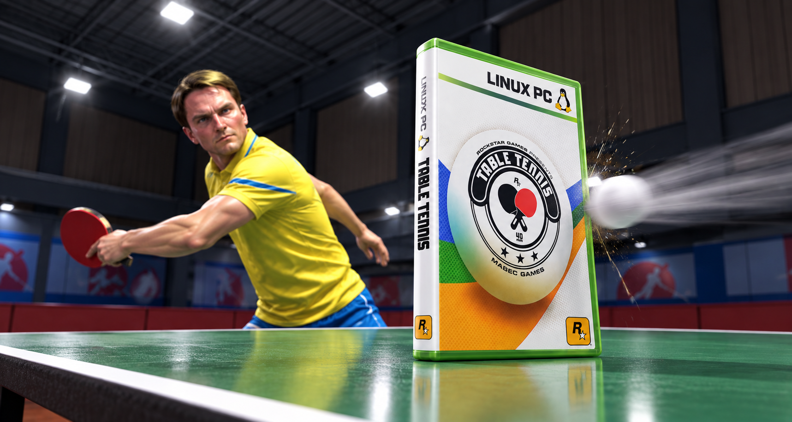
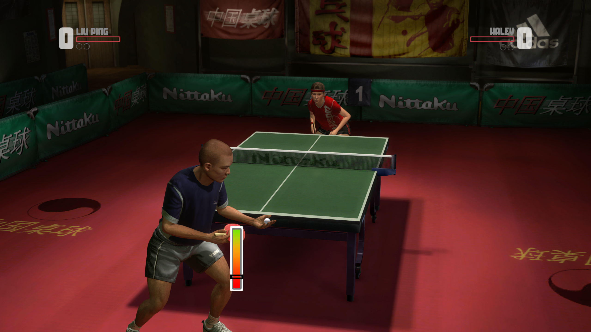
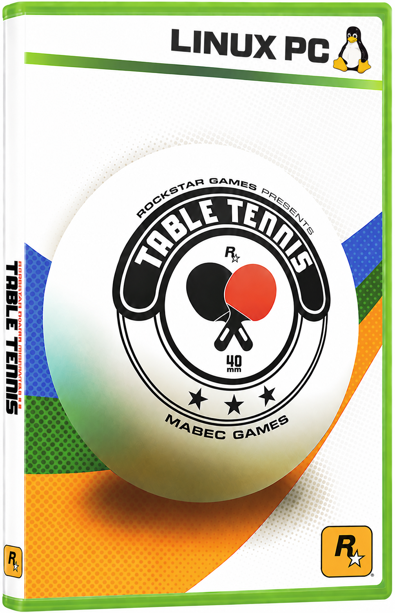

# Rockstar Games presents Table Tennis - Linux v1.1

**Native Linux port by Mabec Games, forked from
[davidptrssvea's Windows PC recompilation](https://github.com/davidptrssvea/Table-Tennis-Rockstar-PC).**

Bring your own Xbox 360 disc image and play with native Linux execution,
Vulkan rendering, a graphical settings launcher, and controller support.
The Windows project's recompilation, ISO support, offline menu and startup
improvements form the foundation of this fork. ReXGlue SDK v0.10.0 provides
the runtime and renderer.

**The Linux AppImage has been tested on CachyOS: both the launcher and game
started correctly with no issues reported.**

> **Pressing Escape immediately quits the game, without a confirmation dialog.**

## What's in Linux v1.1

- **Kernel-independent O(1) guest memory tracking** across `QueryProtect`,
  `Protect`, `AllocFixed`, `DeallocFixed`, `MapFileView`, and `UnmapFileView`,
  eliminating `/proc/self/maps` slowdowns on Linux 6.1–6.10 kernels (including
  SteamOS 3.5/3.6 on Steam Deck and Ubuntu 24.04 GA) as well as Linux 6.11+.
- **Dedicated `800p (Steam Deck)` (`1280x800`) resolution preset** alongside
  **720p, 1080p, 1440p and 4K**, with FXAA/FXAA Extreme and FSR, CAS or
  bilinear presentation options.
- **Linux settings launcher** with saved ISO selection, GPU selection, resolution,
  frame-rate limit, fullscreen/windowed mode and FPS overlay.
- **Native Vulkan rendering**, including the correction for dark character skin.
- **Controller support and working in-game rumble**, confirmed during gameplay.
- **Local AppImage packaging**, bundling the game runtime, graphics plugin,
  Python, Tcl/Tk and launcher. Running that AppImage requires **no separate
  ReXGlue SDK, Python or Tk installation**.
- **Offline menu and intro improvements** inherited from the Windows project.



## Getting started

**[Download the Linux v1.1 AppImage](https://github.com/Mabec-games/Table-Tennis-Rockstar-Linux/releases/download/linux-v1.1/Table-Tennis-Linux-v1.1-x86_64.AppImage)**
from the [Linux v1.1 release](https://github.com/Mabec-games/Table-Tennis-Rockstar-Linux/releases/tag/linux-v1.1).
The release also includes a SHA-256 checksum and source ZIP.

**Players do not need to install the SDK, Python, Tk or a compiler.**
The AppImage bundles the native executable, corrected renderer and runtime.
For developers building their own copy, see [LINUX.md](LINUX.md).

You need your own unmodified **USA/Europe retail Xbox 360 Table Tennis ISO**
(Title ID `545407DF`). The build tools verify it and open it read-only. Keep
the ISO available: the game reads it during play.

Make the downloaded AppImage executable and start it:

```bash
chmod +x Table-Tennis-Linux-v1.1-x86_64.AppImage
./Table-Tennis-Linux-v1.1-x86_64.AppImage
```

Choose the ISO, set **800p (Steam Deck)** on Steam Deck or **1080p** on desktop
with **60 FPS** as a starting point, and press **Play Table Tennis**. Existing
launcher settings are reused.

If FUSE mounting is unavailable:

```bash
./Table-Tennis-Linux-v1.1-x86_64.AppImage --appimage-extract-and-run
```

On the tested hybrid laptop, the Radeon 680M worked through native Wayland but
showed a black window through X11/XWayland. For that configuration:

```bash
SDL_VIDEODRIVER=wayland ./Table-Tennis-Linux-v1.1-x86_64.AppImage
```

This is a result from one laptop, not a requirement for all AMD systems.

## Compatibility and testing

| Platform or configuration | Status |
| --- | --- |
| CachyOS, an Arch-based distribution | AppImage v1.1 launcher and game confirmed working |
| NVIDIA RTX 3080 Laptop GPU, Ryzen 9 6900HS | Recorded 1080p gameplay at approximately 60 guest frames/s |
| AMD Radeon 680M, Ryzen 9 6900HS, native Wayland | Recorded 1080p gameplay near 60 guest frames/s, with a short dip in the sample |
| SteamOS / Steam Deck (Linux 6.1/6.5) | User-space page table (`TABLETENNIS_DISABLE_PROCMAP_QUERY=1`) and `800p (Steam Deck)` preset verified in tests/launcher; physical Steam Deck gameplay testing pending |
| Other current Arch installations | Compatibility target; broader testing needed |
| Debian 13+ and Ubuntu 24.04+ | AppImage compatibility targets; desktop gameplay testing pending |

The current AppImage build targets **x86-64-v3 CPUs, Linux 6.1 or newer and a
working Vulkan graphics driver**. Debian 12 and Ubuntu 22.04 are outside this
build's target. Clean-machine testing remains open.

The 1440p and 4K presets increase internal rendering resolution. On the tested
laptop, 1440p ran noticeably slower than 1080p; turning off FXAA did not remove
that slowdown. Higher frame-rate choices are selectable limits, not verified
performance promises. Start at 1080p/60 FPS.

See [hardware validation](docs/linux-hardware-validation.md) for the evidence
and limitations. The repository includes Debian/Arch launcher smoke tests;
these do not replace desktop graphics testing.

## Controls and local files

| Control | Action |
| --- | --- |
| **Escape** | **Immediately quits the game — no confirmation dialog** |
| **F10** | Toggle the FPS/frame-time overlay |
| Gamepad | Gameplay controls, intro skipping and supported controller rumble |

If a first-run **Saved Game** prompt appears, answer it with the gamepad.

Launcher settings are stored in `~/.config/tabletennis/settings.json`.
Saves use `~/.local/share/tabletennis`. Launcher output goes to
`~/.local/state/tabletennis/game.log`; AppImage runtime logs are under
`~/.cache/tabletennis/appimage/<build-id>/logs/`. The corresponding XDG
environment variables override these defaults.

## Credits

- **Windows recompilation and original integration:** [davidptrssvea](https://github.com/davidptrssvea/Table-Tennis-Rockstar-PC).
  For the Windows version and installer, visit that upstream project.
- **Linux port, launcher presentation and testing:** Mabec Games.
- **Recompilation framework and runtime:** [ReXGlue](https://github.com/rexglue/rexglue-sdk).
- **Windowing, input and controller support:** SDL3.
- **Original Windows icon:** Gary aka POOTERMAN :) —
  [artwork credit](licenses/Icon/CREDITS.txt).
- Presentation artwork and the gameplay screenshot were supplied by Mabec Games.
  See [artwork credits](licenses/LinuxArtwork/CREDITS.md).

<p align="center">
  
</p>

Project-authored integration and tools retain the [MIT license](LICENSE).
ReXGlue-derived files retain their [BSD notices](licenses/ReXGlue/LICENSE.txt);
the [SDL notice](licenses/SDL3/LICENSE.txt) is also retained. Artwork and
original game material are separate from the source-code license.

This is an independent project, unaffiliated with Rockstar Games or Take-Two.
The original game and its branding belong to their respective owners. Supply
your own game ISO; no ISO or XEX is included. The source repository contains
integration code and tools. The separate AppImage release contains the native
compiled game, a patched menu override and bundled runtime dependencies.
